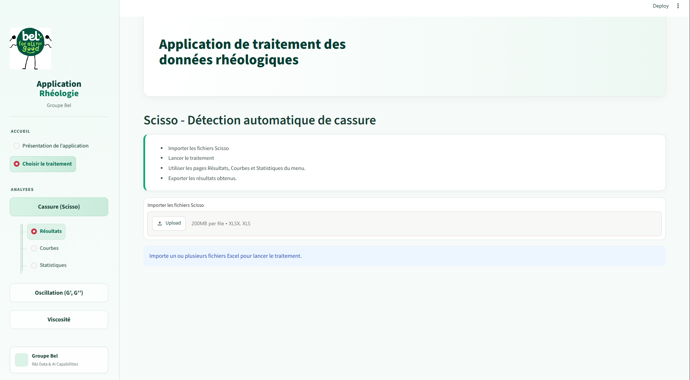
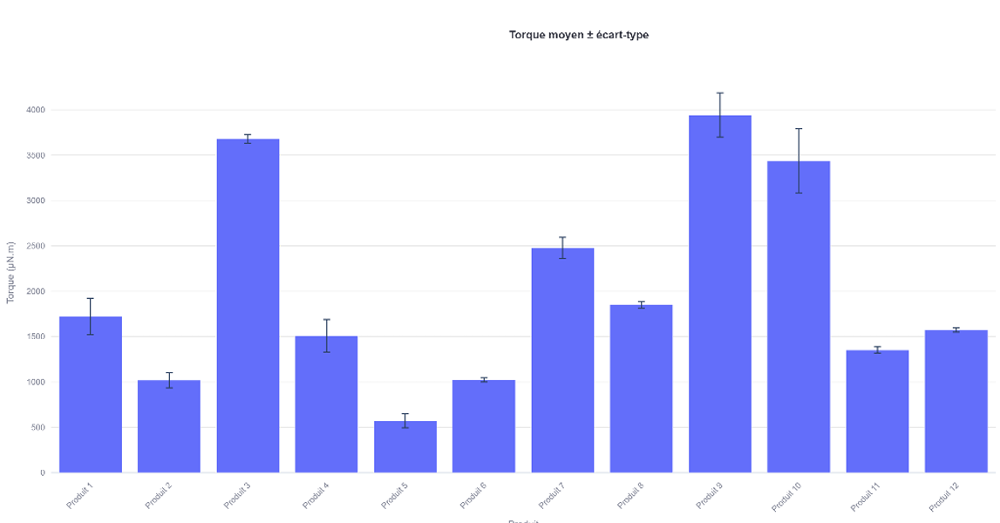
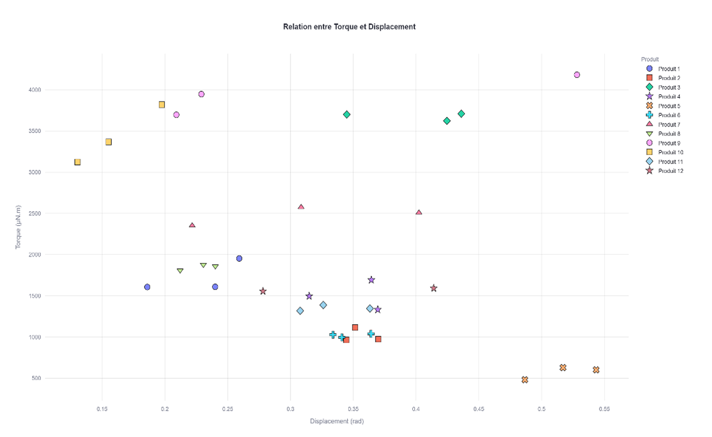

# Analyse et automatisation des données rhéologiques

### Projet Data Analyst R&D | Python • Streamlit • Statistiques

**Stage de fin d'études — Groupe Bel | 2026**

---

## 1. Présentation du projet

Dans le cadre de mon stage de fin d'études au sein du centre de Recherche et Développement du Groupe Bel, j'ai travaillé sur l'automatisation du traitement et de l'analyse de données scientifiques issues de mesures rhéologiques.

La rhéologie permet d'étudier le comportement des matériaux et leurs propriétés mécaniques dans différentes conditions expérimentales.

L'exploitation de ces données nécessite plusieurs étapes : préparation des fichiers, extraction des paramètres caractéristiques, visualisation des courbes et interprétation des résultats.

L'objectif de ce projet était de développer une solution permettant de simplifier et d'automatiser ces traitements, tout en améliorant leur fiabilité et leur reproductibilité.

Pour répondre à ces besoins, j'ai développé une **application web interactive avec Python et Streamlit**, permettant aux utilisateurs de réaliser différentes analyses sans avoir à exécuter directement du code Python.

---

## 2. Objectifs du projet

Les principaux objectifs étaient :

- Automatiser le traitement des données expérimentales.
- Réduire le temps consacré aux opérations manuelles répétitives.
- Standardiser les méthodes d'extraction des paramètres.
- Extraire automatiquement des indicateurs pertinents.
- Faciliter la visualisation et l'interprétation des résultats.
- Intégrer des méthodes d'analyse statistique.
- Améliorer la fiabilité et la reproductibilité des traitements.
- Développer une interface simple et accessible aux experts scientifiques.
- Faciliter la comparaison et l'exportation des résultats.

---

## 3. Technologies utilisées

| Technologie | Utilisation |
|------------|-------------|
| **Python** | Développement et automatisation des traitements |
| **Pandas** | Nettoyage, transformation et structuration des données |
| **NumPy** | Calculs numériques |
| **SciPy** | Calculs scientifiques et tests statistiques |
| **Matplotlib** | Visualisation des données |
| **Streamlit** | Développement de l'application web interactive |
| **Excel** | Importation et exportation des données et résultats |
| **Jupyter Notebook** | Exploration des données et développement |
| **GitLab** | Gestion du projet et déploiement |

---

## 4. Développement de l'application Streamlit

Afin de faciliter l'utilisation des traitements, j'ai développé une application web interactive avec **Streamlit**.

Cette application centralise plusieurs fonctionnalités d'analyse des données rhéologiques et permet aux utilisateurs d'importer directement leurs fichiers expérimentaux.

### Fonctionnalités principales

- Importation simultanée de plusieurs fichiers Excel.
- Identification automatique des données nécessaires aux analyses.
- Sélection des traitements à effectuer.
- Extraction automatique des indicateurs caractéristiques.
- Génération de graphiques pour visualiser les mesures.
- Présentation des résultats sous forme de tableaux.
- Comparaison de plusieurs échantillons et répétitions.
- Réalisation d'analyses statistiques.
- Exportation des résultats vers Excel.

### Aperçu de l'interface

*Interface générale de l'application Streamlit développée pour automatiser le traitement et l'analyse des données rhéologiques.*

---

## 5. Traitement et analyse des données rhéologiques

Dans le cadre de ce projet, j'ai développé plusieurs fonctionnalités permettant d'automatiser l'exploitation des données issues d'analyses rhéologiques.

Les principaux travaux réalisés comprennent :

- **Analyse de refonte :** traitement des courbes rhéologiques, extraction des paramètres caractéristiques et identification automatique des températures de transition.

- **Analyse de cassure :** exploitation des courbes couple-déplacement et contrainte-déformation afin d'identifier et d'extraire les paramètres caractéristiques de cassure.

- **Analyse de viscosité :** traitement des données de viscosité en fonction du temps et du gradient de cisaillement, visualisation des courbes et identification des changements de comportement.

- **Détection des transitions :** développement de méthodes permettant d'identifier des changements de régime à partir de l'analyse des courbes et des intersections de droites ou de tangentes.

- **Automatisation des traitements :** développement de fonctions Python permettant de traiter plusieurs fichiers, d'organiser les répétitions et de standardiser l'extraction des indicateurs.

- **Visualisation et exportation :** génération automatique de graphiques et de tableaux récapitulatifs, avec possibilité d'exporter les résultats vers Excel.

Ces fonctionnalités permettent de centraliser différents types d'analyses dans une même application et de faciliter l'exploitation des résultats expérimentaux.

---

## 6. Analyses statistiques et comparaison des échantillons

### 6.1. Objectif

Une partie importante du projet a été consacrée à l'analyse statistique des paramètres extraits afin d'étudier la variabilité des mesures et de comparer différents groupes d'échantillons.

L'objectif était de compléter les observations graphiques et les statistiques descriptives par des méthodes statistiques permettant d'évaluer la significativité des différences observées entre les groupes.

En effet, les différences constatées entre plusieurs moyennes ne permettent pas, à elles seules, de conclure à l'existence d'une différence statistiquement significative.

L'intégration de tests statistiques permet ainsi d'approfondir l'analyse et de fournir aux experts scientifiques des résultats plus pertinents pour l'interprétation des données expérimentales.

### 6.2. Préparation des données

Avant de réaliser les analyses statistiques, plusieurs étapes de préparation ont été effectuées :

- Regroupement des données par échantillon.
- Identification et organisation des répétitions.
- Vérification des valeurs disponibles.
- Structuration des tableaux de résultats.
- Préparation des variables à comparer.

Ces traitements permettent d'obtenir des données structurées et adaptées aux méthodes statistiques utilisées.

### 6.3. Statistiques descriptives

Une première analyse descriptive permet de résumer les données expérimentales et d'étudier leur variabilité.

Les principaux indicateurs calculés comprennent :

- **Nombre d'observations :** effectif disponible pour chaque groupe.
- **Moyenne :** valeur moyenne des mesures.
- **Écart-type :** indicateur de dispersion des observations autour de la moyenne.
- **Variabilité des mesures :** étude des différences entre les répétitions et les groupes.

Ces indicateurs permettent de décrire les caractéristiques générales des échantillons et de mettre en évidence les premières différences observées.

Cependant, les statistiques descriptives ne suffisent pas à déterminer si les différences entre les groupes sont statistiquement significatives.

### 6.4. Tests statistiques

Afin d'approfondir les comparaisons, plusieurs tests statistiques ont été intégrés aux traitements.

#### Test de Levene

Le **test de Levene** permet d'évaluer l'homogénéité des variances entre plusieurs groupes.

Il consiste à tester l'hypothèse selon laquelle les variances des différents groupes sont égales.

Ce test constitue une étape importante pour orienter le choix de la méthode de comparaison des moyennes.

#### Analyse de variance (ANOVA)

L'**analyse de variance (ANOVA)** permet de comparer les moyennes de plusieurs groupes.

Lorsque ses conditions d'application sont satisfaites, elle permet de tester l'hypothèse d'égalité des moyennes.

Un résultat statistiquement significatif indique qu'au moins une moyenne diffère des autres, sans nécessairement identifier directement les groupes concernés.

#### ANOVA de Welch

Lorsque l'hypothèse d'homogénéité des variances n'est pas satisfaite, une **ANOVA de Welch** peut être utilisée.

Cette méthode est adaptée à la comparaison des moyennes lorsque les variances des groupes sont inégales.

Elle permet de tenir compte de l'hétérogénéité des variances et d'obtenir une analyse plus adaptée aux caractéristiques des données.

Le choix de la méthode statistique dépend ainsi des propriétés des données et des conditions d'application des tests.

### 6.5. Visualisation des résultats statistiques

Les résultats statistiques sont présentés sous forme de graphiques et de tableaux afin de faciliter leur interprétation par les experts scientifiques.

Les visualisations permettent notamment :

- De comparer les moyennes entre plusieurs groupes.
- De représenter la variabilité des mesures.
- D'observer les écarts entre les échantillons.
- De faciliter la lecture des résultats statistiques.

#### Comparaison des moyennes et des écarts-types

*Visualisation comparative des moyennes et de la dispersion des mesures entre différents groupes d'échantillons.*

Ce type de représentation permet d'observer les différences entre les groupes tout en tenant compte de la variabilité des mesures.

Les barres d'erreur facilitent l'interprétation des résultats expérimentaux, mais ne permettent pas, à elles seules, de conclure à une différence statistiquement significative.

#### Étude de la relation entre deux variables : couple et déplacement

*Visualisation de la relation entre le couple et le déplacement à partir des mesures expérimentales.*

Cette analyse permet d'étudier le comportement conjoint de deux variables quantitatives et d'observer la manière dont le couple évolue en fonction du déplacement.

La représentation graphique facilite notamment :

- L'observation de la forme générale de la relation.
- L'identification d'éventuelles tendances.
- La comparaison des comportements entre les échantillons.
- La détection de valeurs atypiques ou de changements de comportement.

L'étude de cette relation complète les analyses descriptives et contribue à une meilleure compréhension des mesures expérimentales.

### 6.6. Apports des analyses statistiques

L'intégration des méthodes statistiques dans l'application permet :

- De compléter les analyses descriptives par des tests statistiques.
- D'étudier la variabilité des mesures expérimentales.
- De comparer plusieurs groupes d'échantillons.
- D'adapter les méthodes statistiques aux caractéristiques des données.
- De faciliter l'identification et l'interprétation des différences observées.
- De présenter les résultats de manière claire et exploitable.
- De communiquer les conclusions aux experts scientifiques ne disposant pas nécessairement de compétences approfondies en statistique.

---

## 7. Résultats et apports du projet

Le développement de cette application a permis de centraliser plusieurs traitements de données scientifiques dans une interface unique.

### Gain de temps significatif

L'un des principaux apports du projet concerne la réduction du temps consacré aux traitements manuels.

Grâce à l'automatisation développée avec Python, **plusieurs centaines de fichiers peuvent être traités en quelques minutes**, alors que leur exploitation manuelle nécessitait auparavant de nombreuses opérations répétitives.

Cette automatisation permet aux utilisateurs de consacrer davantage de temps à l'analyse et à l'interprétation des résultats.

### Automatisation des traitements

Les traitements ont été automatisés afin de faciliter l'exploitation simultanée de plusieurs fichiers expérimentaux.

Cette approche limite les interventions manuelles et simplifie l'extraction des indicateurs.

### Fiabilité et reproductibilité

Le développement de fonctions Python permet de standardiser les traitements et d'appliquer des méthodes cohérentes aux différentes données analysées.

Cette standardisation contribue à améliorer la fiabilité et la reproductibilité des résultats.

### Extraction automatique des indicateurs

Les paramètres caractéristiques sont extraits automatiquement puis organisés dans des tableaux récapitulatifs.

Les utilisateurs peuvent ainsi consulter, comparer et exporter les résultats plus facilement.

### Visualisation des données

La génération de graphiques facilite l'exploration des mesures expérimentales et l'interprétation des résultats.

Les visualisations permettent également de vérifier les paramètres détectés automatiquement.

### Analyses statistiques

L'intégration de méthodes statistiques permet d'approfondir les comparaisons entre les échantillons et d'étudier la variabilité des mesures.

### Accessibilité de l'application

L'interface Streamlit facilite l'utilisation des traitements par les experts scientifiques, sans nécessiter de connaissances en programmation Python.

---

## 8. Collaboration et déploiement

Le projet a été réalisé en collaboration avec les équipes scientifiques et Data du Groupe Bel.

Les échanges avec les experts métier ont permis de :

- Comprendre les besoins liés aux analyses expérimentales.
- Identifier les paramètres pertinents à extraire.
- Adapter les traitements aux caractéristiques des données.
- Vérifier et valider les résultats obtenus.
- Améliorer la présentation des graphiques et des tableaux.
- Faciliter l'utilisation de l'application par les équipes.

Une attention particulière a été portée à la communication des résultats auprès d'experts scientifiques ne disposant pas nécessairement de compétences en programmation ou en analyse de données.

Après validation des traitements, l'application a été intégrée dans un environnement GitLab afin de faciliter son déploiement et sa mise à disposition des utilisateurs.

---

## 9. Compétences développées

### Compétences techniques

- Analyse et traitement de données scientifiques.
- Programmation Python.
- Nettoyage, transformation et structuration des données.
- Automatisation des traitements.
- Extraction automatique d'indicateurs.
- Analyses statistiques descriptives et inférentielles.
- Visualisation et interprétation des données.
- Développement d'applications web avec Streamlit.
- Gestion et exploitation des fichiers Excel.
- Utilisation de GitLab.

### Compétences transversales

- Analyse des besoins utilisateurs.
- Résolution de problèmes techniques.
- Travail en autonomie.
- Collaboration avec des équipes pluridisciplinaires.
- Communication des résultats d'analyse.
- Vulgarisation des méthodes statistiques.
- Adaptation à un environnement de Recherche et Développement.

---

## 10. Confidentialité

Ce dépôt GitHub a pour objectif de présenter une synthèse des travaux réalisés et des compétences développées dans le cadre de ce projet.

**Le code source de l'application, les données expérimentales internes et les informations confidentielles du Groupe Bel ne sont pas publiés.**

Les captures d'écran et illustrations éventuellement présentées dans ce dépôt doivent être autorisées pour diffusion publique ou réalisées à partir de données entièrement fictives.

Ce dépôt est uniquement destiné à la valorisation de mon expérience et de mes compétences professionnelles.

---

## 11. À propos

**Celia ISSAOUN**

**Data Analyst Junior**

Diplômée d'un Master 2 Mathématiques appliquées, statistiques — parcours **Statistiques Appliquées et Analyse Décisionnelle**.

**Université de Caen Normandie — 2026**

Spécialisée dans le traitement, l'analyse statistique et la visualisation des données, avec un intérêt particulier pour l'automatisation des traitements et le développement de solutions facilitant l'exploitation des données.

### Me retrouver

- **GitHub :** https://github.com/celia-issaoun
- **Portfolio :** https://celia-issaoun.github.io/

---

*Projet présenté dans le cadre de la valorisation de mes compétences professionnelles. Le code source et les données confidentielles de l'entreprise ne sont pas accessibles publiquement.*
